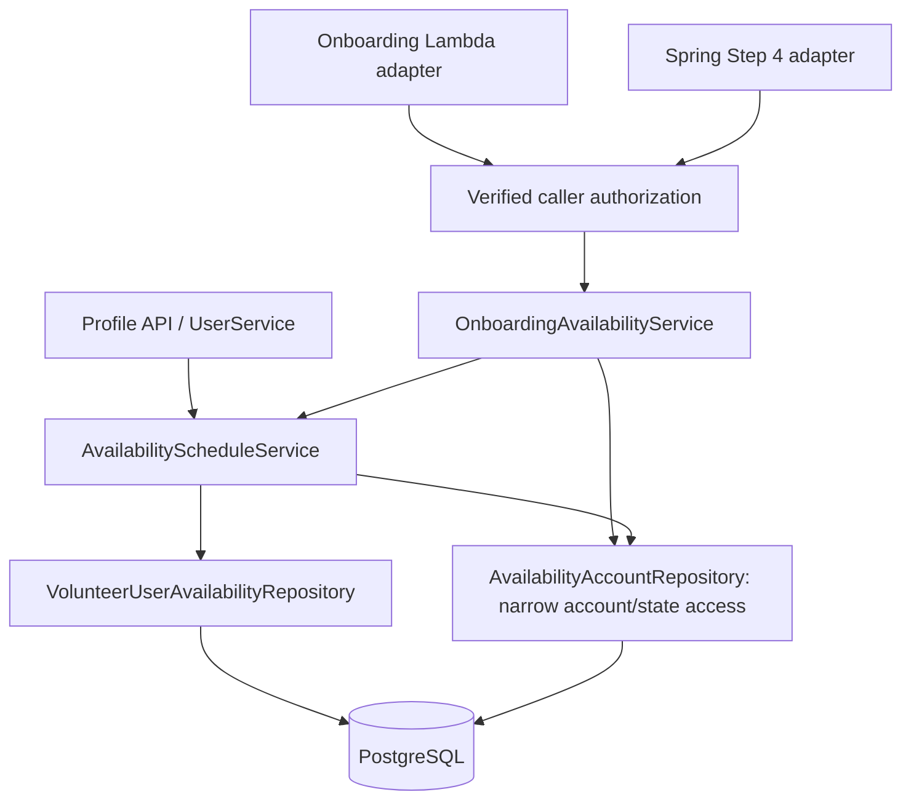

# BA 33 technical design

Status: revised after two independent reviews against [requirements.md](requirements.md); findings and recheck are recorded in review-findings.md. Local implementation was authorized by the user on 2026-10-30; progress and verification are tracked in tasks.md.

## Baseline and approach

The local branch uses `test` at `09b0a33a2c76f30889cd3d6f51f75a4420717745`. This includes PR 215 at `9dc599cd7c851fdde9ac3ca34c97b3b7e06418a3` and the Profile availability follow-up in PR 224. Onboarding uses shared schedule normalization, storage and conversion while preserving the upstream Profile API behavior.

The upstream follow-up provides a timezone-only write, Profile ownership checks, a handler integration test, and DST gap rejection in the shared converter. The local extraction keeps the timezone-only write under the common account lock, and the onboarding service maps the converter's gap rejection to its typed 400. T4 can reuse upstream ownership infrastructure where it satisfies R11. The onboarding API and its verified-caller tests remain assigned to T4.

Verified constraints: current Step 4 writes JSON to `volunteer_details`; PR 215 replaces `user_availability` rows using UTC timestamps; current `users` mapping has known drift, so the feature must not depend on hydrating the entire legacy User entity; the shared development DB lacks the required emergency column.

## Structure and responsibilities



- `AvailabilityScheduleService`: extract PR 215's existing schedule normalization, validation, UTC conversion, replacement, and projection into a shared internal component. Profile keeps its current options and response grouping. Onboarding supplies its stricter policy and requests flat weekday rows. Reuse `AvailabilityTimeConverter`; do not implement a second timezone algorithm.
- `OnboardingAvailabilityService`: enforce Step 4 rules; verify account and volunteer existence; coordinate schedule, emergency flag and monotonic wizard progress in one transaction; expose save/read use cases.
- `AvailabilityAccountRepository`: separate narrow projections/native SQL or JDBC. Base queries select ID, timezone, ownership email and existing wizard fields only; Profile never selects the new emergency column. Onboarding-only state queries additionally select the emergency boolean after the schema-readiness check. Do not add that field to the global User entity. A lazy JPA User reference supplies slot FK identity without loading unrelated columns. Test Profile on a schema without the emergency column.
- Profile `UserService.get/updateAvailability`: delegate to the shared component while preserving request/response semantics. Limit related user reads/writes to narrow account fields; other UserService behavior is outside scope.
- Adapters: validate JSON shape, resolve verified caller identity, authorize the target account, map domain errors to actual HTTP responses, and delegate. They do not implement scheduling logic or print payloads.

## Public contract

Spring canonical path: `POST` and `PUT /0.0.1/volunteers/onboarding/availability`. Proposed API Gateway path: `POST`, `PUT`, `OPTIONS /v1/volunteer/onboarding/availability` to a dedicated `OnboardingAvailabilityHandler`. Route creation/deployment is a handoff, not a local implementation action.

Read request:

```json
{ "userId": "SID-EXAMPLE" }
```

Save request:

```json
{
  "userId": "SID-EXAMPLE",
  "step": 4,
  "availability": [
    { "dayOfWeek": "Monday", "startTime": "09:00", "endTime": "12:00" },
    { "dayOfWeek": "Monday", "startTime": "14:00", "endTime": "17:00" }
  ],
  "isEmergencyAvailable": true
}
```

Response uses the existing `SaayamResponse` envelope. `data` contains `userId`, `isEmergencyAvailable`, `promotionWizardStage`, and `availability: [{id, dayOfWeek, startTime, endTime}]`. Times are local `HH:mm`; rows are sorted Monday–Sunday then start/end. Everyday saves seven rows and is returned as individual days, so editing one day is unambiguous. IDs are opaque and may change on full replacement.

DTOs are separate from Profile DTOs. Onboarding accepts weekdays and Everyday only. The emergency flag is required and explicit, preventing an omitted field from silently resetting a saved preference. No timezone is accepted from this request: use the account's stored IANA zone and return 409 if missing/invalid. No fallback to the server timezone or UTC.

### Retained entry-point contract

| Entry point | Concrete behavior after this change |
|---|---|
| Canonical POST/PUT onboarding path | Uses the read/save contracts above and the same onboarding response data. |
| `PUT /0.0.1/volunteers/updatestep4` | Accepts the exact canonical save shape, including step 4, strict HH:mm and explicit emergency boolean; delegates to onboarding orchestration and returns its canonical response. |
| `PUT /0.0.1/volunteers/updatevolunteer`, body step 4 | Inspect the step before binding the old DTO; bind `OnboardingAvailabilitySaveRequest` and delegate to the same use case. Steps 1–3 retain their existing contracts. |
| `UpdateVolunteerHandler`, body step 4 | Same dispatch, identity validation, status and envelope as the canonical Lambda handler; other steps retain existing routing. |
| Old ISO/date-time Step 4 payloads | Return actual HTTP 400 / BAD_REQUEST with a message to submit local HH:mm and the explicit emergency flag. Do not strip offsets or silently reinterpret dates. This is a documented Step 4 contract cutover; frontend adaptation is a rollout gate. |
| Internal `VolunteerService.updateVolunteerStep4(VolunteerRequest)` calls | Remove the JSON writer; no internal legacy DTO may bypass the new validation. Make the service contract typed to the new save DTO or reject this obsolete internal call explicitly; all HTTP routes above route to the new service before old DTO binding. |
| `PUT /0.0.1/volunteers/updatecompletion` | Missing step retains the historical default of 4, but stage 4 completion is now an idempotent acknowledgement only if already reached through valid save; otherwise 409. Target 5 requires current stage >=4 and valid persisted onboarding state; allow only targets 4 or 5, never decrease a stage. Apply the same verified-owner policy. |
| `UserService.updateUserProfile` / profile update DTO stage fields | Take the common user-row lock before reading or mutating the User; refresh any already-managed User under that lock before applying other profile fields. Omitted stage/timestamp preserves server-owned progress; supplied unchanged values are tolerated; supplied changes return 400. Never copy client progress into the entity or save a stale stage snapshot. |
| `UserService.updateUserPreferences` | Although it changes language fields only, its full-User JPA update can also write a stale stage snapshot. Acquire the common account lock and refresh any managed User before changing preferences; preserve the existing preference request/response contract. Cover a stale preferences update racing onboarding save. |
| Retained Step 1–3 progress updates | Replace the full-User progress save in `updateUser` with a narrow locked update using `GREATEST(COALESCE(promotion_wizard_stage, 0), requestedStep)`. Do not dirty the previously loaded User's stage/timestamp and later save that stale entity. Keep each step's own fields and routing unchanged. |

Use separate `OnboardingAvailabilitySaveRequest`, `OnboardingAvailabilityReadRequest`, `OnboardingAvailabilitySlot` and response DTOs. Do not mutate the shared legacy LocalDateTime slot DTO to mean something different for other steps. Fix the erroneous `@NotBlank Integer step` in `VolunteerRequest` to `@NotNull` only where it remains used. Step-4 adapters must dispatch before trying to deserialize LocalDateTime values or running that legacy DTO's Bean Validation.

Stage writers are explicitly inventoried: VolunteerService's step 1–3 updates, the removed Step 4 JSON writer, its completion endpoint and UserService profile updates. Every retained progress update uses the same per-user lock/order and a monotonic, narrow database update; it must not overwrite newer state with a cached full-User save. The Step 4 save, completion acknowledgement and profile-update guard close the known paths that can independently mark this feature complete. This adds no new earlier-step sequencing restriction or admin stage override. Test save Step 4 -> edit Skills -> stage stays >=4, plus a stale/concurrent earlier-step update racing the save.

Implementation inspection also identified `updateUserPreferences` as an implicit stage writer because Hibernate updates the full User row. T6 includes the same lock/refresh protection there; this is part of R9's existing stale-update guarantee, not a new preferences feature.

Earlier-step handlers also refresh any already-managed Volunteer after acquiring the common account lock, before changing that step's fields. Otherwise a stale full-row save could resurrect JSON availability that a concurrent canonical replacement cleared. Test this stale-entity case alongside the progress races.

Read returns an empty list for an existing volunteer with no saved schedule. It returns any existing Profile-originated overnight slots faithfully, without mutating them. Onboarding save still rejects such intervals and requires the client to correct them explicitly.

## Validation and compatibility policy

1. Validate identity, user ID, `step=4`, explicit boolean flag, and a nonempty array of at most 20 input slots (provisional bound A4).
2. Parse each day/time strictly; reject null items, unknown labels, dates, offsets, seconds, missing fields, equal/reversed ranges and unsupported group labels.
3. Expand Everyday into seven local weekdays. Reject every same-day intersection, including exact duplicates and Everyday/weekday intersections. Touching intervals are accepted.
4. Normalize before persistence. Profile continues to allow empty/overnight schedules and exact de-duplication, so shared validation must take an explicit mode/policy rather than modify Profile rules globally.
5. Preserve PR 215's UTC timestamp and DST-anchor semantics. A redesign of recurring-time storage is outside this feature; its known downstream-reader contract remains documented.
6. The upstream shared converter rejects nonexistent local times on the next occurrence. Onboarding maps this rejection to its typed 400 and checks that the UTC round trip preserves the submitted interval. Profile retains the synced upstream converter behavior.

## Transaction and concurrency

- Begin the write transaction at the public onboarding application-service boundary (`rollbackFor=Exception.class`). The shared component participates in that transaction; it never starts `REQUIRES_NEW`. JPA and JdbcTemplate use the same configured DataSource and Spring transaction manager; no manually opened auto-commit connection is allowed.
- Acquire a per-user row lock with a parameterized `SELECT user_id, time_zone, primary_email_address, promotion_wizard_stage FROM users WHERE user_id = ? FOR UPDATE` before reading mutable state and replacing slots. The configured search_path selects the schema. Profile writes use the same repository lock, in the same user-row-then-slot-rows order. Failure to find the row yields 404 before any slot operation.
- Authorize, verify existence, validate request and stored timezone, delete old rows and flush, insert replacement rows, update emergency preference, and set wizard stage to `max(previousStage, 4)` with the current UTC progress timestamp.
- Return only after successful transaction completion. No success response or wizard advance on failure. Put Spring `@Transactional(readOnly=true, isolation=REPEATABLE_READ)` on the externally invoked Profile `UserService.getAvailability`, onboarding read boundary, and volunteer/steward read boundaries that assemble account/timezone plus slot projections. It must override the existing class-level Jakarta annotation at that outer boundary; annotating only a joined inner method cannot strengthen the snapshot. Completion checks use the write lock and a write transaction.
- Reads and native updates use the configured schema; do not hardcode Virginia. Configure `currentSchema` for native SQL or use a correctly configured qualified repository. Do not concatenate a client-provided schema name.
- A write failure at any point rolls back all affected rows/flags/progress. Test real rollback, not only mock call ordering.

## Schema proposal

Provide an additive, separately deployable SQL script for the operator-configured search_path. In one transaction, require the intended schema and users table to resolve, inspect any existing emergency column, and fail on a non-boolean type before changing it. Add a missing boolean column; backfill existing NULLs to FALSE; set DEFAULT FALSE and NOT NULL; preserve all existing TRUE values. Re-running must be safe. The operator supplies a schema through the connection/search_path, not a client request or unchecked string interpolation. No destructive down migration. Do not run it against shared environments.

Before onboarding state queries, a feature-scoped schema-readiness check verifies the emergency column and required availability fields. Missing/incompatible onboarding schema returns a sanitized 503 FEATURE_UNAVAILABLE without attempting writes. It does not fail the whole application or make Profile queries select the emergency column.

Use `user_availability.start_time`, `end_time`, and `last_updated_at` as timestamp-without-time-zone values compatible with PR 215 and the observed schema. Use `users.promotion_wizard_last_updated_at`, not the older `...last_update_date` spelling. The fixture must mirror these names and not hide mismatches with Hibernate-generated tables.

### Canonical-storage cutover and existing readers

Inventory: `VolunteerServiceImpl.mapToVolunteerResponse` serves the single volunteer and paginated volunteer responses; `StewardServiceImpl.mapToResponse` serves steward volunteer lists. Replace their availability field sourcing with a batch relational projection for the requested IDs: one account/timezone query and one slots query per batch/page, not per volunteer. Project stage from narrow account fields rather than triggering a full legacy User load.

Keep the legacy response keys `availabilityDays` and `availabilityTimes`. For relational schedules, days are local weekday labels; time items keep `{id, dayOfWeek, startTime, endTime}` with UTC ISO date-time strings derived from the stored instants, matching the previous ISO input representation. The new canonical onboarding response separately uses local HH:mm. Document and contract-test this distinction.

If relational rows are empty and old JSON is nonempty, canonical onboarding/Profile reads return 409 LEGACY_AVAILABILITY_MIGRATION_REQUIRED rather than an empty schedule. Existing volunteer/steward responses preserve that legacy JSON verbatim and add `availabilityMigrationRequired: true`, so existing schedules do not disappear. Otherwise return the derived relational fields with the flag false. Legacy JSON is a migration diagnostic, never silently converted into canonical rows.

Every successful shared schedule replacement (Profile or onboarding), including a Profile clear, clears that user's obsolete JSON fields in the same transaction. Zero matching volunteer_details rows is valid for a Profile-only user. This prevents a later relational clear from resurrecting an old schedule or being mistaken for an unmigrated record. Do not access the emergency column on Profile operations.

Automatic bulk conversion of historical ISO/local JSON is deferred. Before rollout, the DB/product owner must inventory affected accounts and select reviewed backfill or explicit user re-entry. An onboarding save with a fully specified new schedule can replace a legacy-only record normally; it clears the legacy cache only if the entire transaction commits. No shared-data migration is executed by this work.

## Authorization and errors

For the dedicated Lambda handler and retained Step 4 dispatch, consume REST API Gateway `requestContext.authorizer.claims`: require an authenticated subject, a verified email claim and email_verified=true, then compare the normalized email against the specific target user with a narrow query. The gateway validates token signature/issuer/audience; the Lambda resource policy restricts invocation to authorized infrastructure. Do not use the body ID as proof of ownership, accept free-form `cognitoEmail` fallbacks, or infer admins using substring checks. This self-service feature adds no new admin override. API Gateway HTTP API v2 payloads are not part of this initial REST-event contract.

For Spring, use the existing `StreamLambdaHandler` / AWS serverless container bridge. Read the typed `AwsProxyRequestContext` servlet attribute named by `RequestReader.API_GATEWAY_CONTEXT_PROPERTY` (verified in dependency 2.0.2 as `com.amazonaws.apigateway.request.context`), then `getAuthorizer().getClaims()`. Apply exactly the same verified-subject/email/ownership policy. Only the serverless request reader creates this attribute; HTTP headers or JSON cannot substitute for it.

Standalone Spring HTTP currently has no authenticated-principal bridge. Direct requests to the new/retained Step 4 routes therefore intentionally return 403; this design does not claim they are usable with an arbitrary local JWT or X-Caller header. Authorized local Spring integration tests invoke the real StreamLambdaHandler/container with a synthetic API Gateway authorizer event and assert the controller receives the actual bridged context. Dedicated-Lambda tests invoke its public handler with the same event fixture. This tests the real adapter rather than fabricating a request attribute in MockMvc. Standalone Spring JWT integration and HTTP API v2 support are explicitly deferred capabilities; if either topology is required, rollout must wait for that integration.

| Situation | HTTP |
|---|---|
| Save/read success | 200 |
| Bad JSON, missing fields, invalid schedule or step | 400 |
| Missing verified context or wrong owner | 403 |
| Unknown user or volunteer record | 404 |
| Missing/invalid account timezone | 409 |
| Legacy JSON-only schedule requires migration | 409 |
| Required onboarding schema is absent/incompatible | 503 |
| Unexpected storage/application failure | 500 |
| OPTIONS / unsupported method | 204 / 405 |

Use feature-scoped exception mapping so unrelated endpoints are not inadvertently changed. Both Spring and Lambda assert the real HTTP status, not just `statusCode` in the JSON envelope.

## Testing and task boundaries

TDD is mandatory for coding agents: one failing behavioral test through a public interface, minimal passing implementation, then refactor with tests green. Do not create all tests first or split testing into a cleanup task after implementation.

Use isolated local PostgreSQL with synthetic accounts and the observed schema plus the proposed additive column. Never reuse the team YAML, remote credentials, or shared database in write tests. Docker is currently unavailable; a separate native local PostgreSQL cluster/port is a supported test option, without touching the user's existing PostgreSQL service data.

Inject `java.time.Clock` (production default Clock.systemUTC) into the extracted shared schedule component and derive `today` in the account zone from that clock. Tests use Clock.fixed. This is the explicit seam replacing PR 215's direct LocalDate.now(zone) calls, while preserving production semantics.

Prioritize: valid save/read; invalid input with unchanged prior state; Everyday/duplicate/adjacent intervals; emergency false/true; replacement and deletion; real rollback; non-regressing stage; completion and profile-stage bypasses; concurrent Profile/onboarding replacement; non-UTC/DST cases; unauthorized caller; actual HTTP statuses; unchanged Profile contract on a pre-emergency schema; migration rerun and TRUE/NULL/type cases; legacy JSON-only visibility. Use two physical PostgreSQL connections and deterministic barriers for concurrent timezone+schedule writes and REPEATABLE READ visibility; no sleep-based concurrency assertion. H2 tests may supplement PostgreSQL but cannot certify PostgreSQL column types, native SQL, locking, or rollback behavior.

The orchestrator owns sequencing and integration. Coding tasks must have explicit files/interfaces and dependencies so two agents do not concurrently edit the same shared service. Parallelize independent adapters/docs only after service and contract interfaces are stable. No coding agent is spawned until the user explicitly requests implementation.

## External integration and release gates

- DB owner reviews/applies the emergency-column migration before enabling feature traffic.
- Frontend owner adopts strict HH:mm, explicit emergency preference, save/read integration and error handling before moving to Review.
- Gateway owner configures authenticated routes and trusted identity propagation; verify on the intended deployment topology before release.
- Verify the intended audience and effective gateway authorization for existing volunteer detail/list and steward volunteer readers, plus volunteer create and Step 1–3 routes that return the same volunteer response. These responses can now contain relational schedules saved in Profile. The legacy Spring readers and Step 1–3 flows do not enforce caller ownership in the application. Keep those routes behind the approved access policy on the target deployment.
- Switch or disable every old JSON-only Step 4 writer before enabling relational saves. Coordinate Spring and Lambda route aliases during rollout and rollback. An old writer can otherwise report a successful JSON save that relational-first readers ignore.
- Historical stage-4 records with valid relational schedules can satisfy the completion check after migration. The existing fields cannot distinguish an earlier completion or Profile save from an explicit onboarding save. Confirm with the DB and product owners whether affected records require re-entry before rollout.
- The synced `test` baseline includes the Profile Availability foundation. The lead confirms the eventual PR target. No GitHub push is authorized for the agent.
- Product confirms the provisional 20-slot input limit and frontend editing behavior. Reads return expanded weekdays, so three `Everyday` inputs can reload as 21 rows. The frontend can regroup identical seven-day intervals for resubmission. Some edits to a schedule near the limit can still require more than 20 entries.
- Account owners remediate invalid/missing stored timezones before rollout (derived assumption A6).
- Historical JSON-only records require owner-approved inventory/backfill or re-entry. Automatic bulk conversion is deferred; the code must preserve visibility and return the explicit migration-required response.
- Deployment must use the supported REST API Gateway + Cognito context topology. Standalone Spring JWT authentication and HTTP API v2 support are deferred and may not be claimed as tested/supported.

See [review findings](review-findings.md) for review dispositions and [tasks](tasks.md) for local implementation and verification evidence.
