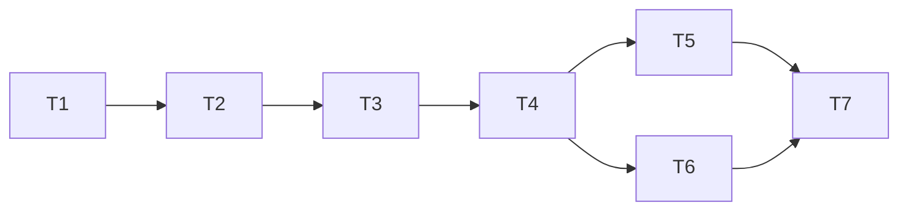

# BA 33 implementation tasks and task graph

Status. T1 through T7 are complete locally on the synced `test` baseline at `09b0a33`. [Review findings](review-findings.md)

## Orchestration contract

The main chat is the orchestrator. It checks the baseline, assigns a bounded task, supplies the current contracts and requirement IDs, resolves ownership conflicts, integrates changes, and evaluates evidence before unblocking downstream tasks. A passing local test does not authorize a GitHub push, migration deployment or issue-status change.

Each coding sub-agent must read `C:/Users/saima/.codex/skills/tdd/SKILL.md` before coding and use vertical red–green–refactor cycles: one meaningful behavioral failing test, minimum implementation, then refactor while green. Do not write a bulk suite before implementation or leave all tests to T7. Use public application/HTTP/handler interfaces; database metadata and migration checks are appropriate for the separate schema contract. A red test must fail for the intended missing behavior, not a broken toolchain or accidental remote connection.

All database write tests use isolated local PostgreSQL, a dedicated port/database and synthetic records. Test configuration must override tracked runtime datasource settings, must not load the team application.yaml, and must not inherit a remote SPRING_CONFIG_ADDITIONAL_LOCATION or remote datasource. Support the existing H2 tests without forcing a PostgreSQL driver onto their URLs. No shared credentials, DB writes, commits, pushes, PR updates or deployment actions are authorized.

## Task graph

`Blocked by` contains direct prerequisites. `Blocks` contains direct dependents. The Mermaid graph uses the same edges.

| ID | Task | Blocked by | Blocks | Status |
|---|---|---|---|---|
| T1 | Shared schedule persistence and regression foundation | None | T2 | Complete |
| T2 | Onboarding save/read tracer and emergency schema contract | T1 | T3 | Complete |
| T3 | Onboarding validation, editing and atomic-state behavior | T2 | T4 | Complete |
| T4 | Spring/proxy API and verified-owner contract | T3 | T5, T6 | Complete |
| T5 | Dedicated Lambda and generic Lambda Step 4 integration | T4 | T7 | Complete |
| T6 | Legacy reader cutover and remaining progress-writer guards | T4 | T7 | Complete |
| T7 | End-to-end verification, handoff and final review | T5, T6 | None | Complete locally |



Only T5 and T6 are initially parallel-safe. The earlier tasks deliberately serialize changes to shared persistence and policy. The orchestrator may split tasks further if evidence shows a clean interface boundary, but must update both dependency columns and the graph before delegation.

## T1 Shared schedule persistence and regression foundation

**Owner:** one coding sub-agent. **Requirements:** R7, R10, R13 foundations; D3/D5/D7 review corrections.

**Owned areas:** new `AvailabilityScheduleService`, base account projections/repository, existing Profile availability delegation in `UserServiceImpl`, injected Clock, existing slot repository as needed, isolated test configuration/fixtures and new public-service regression tests. Do not change unrelated UserService behavior or onboarding adapters.

**First TDD slice:** on a sparse current-schema PostgreSQL fixture with no emergency column and no obsolete User columns, exercise Profile save/read through its public service interface. Record the intended failure of the old full-User access, then introduce narrow account access and shared persistence until it passes.

**Incremental work:** preserve Profile empty clears, overnight slots, grouping/de-duplication and response contract; move conversion behind the injected Clock; same per-user row lock and outer read isolation; fixed-clock and two-connection concurrency tests. Capture the unmodified baseline results before editing. Constructor/test wiring changes are allowed, but existing behavioral assertions must be preserved or replaced with equivalent public-behavior coverage, never deleted merely to make extraction pass.

**Done:** Profile works without the emergency migration; no global emergency field on User; source schema names match the fixture; shared persistence is transaction-participating and safe for the next onboarding slice. Report the exact public internal service/repository interfaces T2 may use.

## T2 Onboarding save/read tracer and emergency schema contract

**Owner:** one coding sub-agent. **Requirements:** R1, R7–R9, R12 schema readiness; R13 account-state prerequisite.

**Owned areas:** separate onboarding request/response DTOs and application service, onboarding-only account projection/state update, additive migration artifact, schema-readiness check and isolated PostgreSQL migration/round-trip tests. May adapt the obsolete internal Step 4 service call to remove its JSON writer; preserve all unrelated steps.

**First TDD slice:** an existing synthetic volunteer with a valid stored timezone saves one valid slot and explicit emergency=true; a public read returns that schedule/flag and stage >=4. Use T1's shared storage rather than another CRUD implementation.

**Incremental work:** emergency=false round trip, replacement, user/volunteer missing cases, missing schema -> sanitized 503 without writes, invalid account zone ->409. Migration tests: absent column, existing nullable boolean with TRUE and NULL, rerun, wrong type failure and transaction rollback. No script is applied to shared environments.

**Done:** one complete onboarding save/read path persists slots, emergency and monotonic progress atomically. Public DTO/response and error contracts are stable for T3/T4. Profile's pre-emergency fixture still works. Migration prerequisites are documented, not assumed deployed.

## T3 Onboarding validation, editing and atomic-state behavior

**Owner:** one coding sub-agent. **Requirements:** R2–R6, R8–R10, R13.

**Owned areas:** onboarding policy/normalizer and its public-service behavior tests, plus onboarding service coordination only where the next failing test requires it. Profile validation semantics are not changed.

**First TDD slice:** attempting an overlapping second Monday interval returns validation failure and leaves the prior full schedule, emergency flag and stage unchanged.

**Incremental work:** strict HH:mm/day parsing; missing/null/empty cases; equal/reversed ranges; Everyday expansion before duplicate/overlap checks; adjacent slots; proposed 20-input-slot bound; deleting old slots on replace; readback of Profile-originated overnight slots without rewriting them; injected persistence failure rollback; stage does not regress. Force real transaction failures and use fixed-clock non-UTC/DST cases. Profile empty/overnight/de-duplication behavior remains covered.

**Done:** no invalid schedule can partially persist or mark onboarding complete; endpoint adapters can rely on typed errors and the stable service contract. Review the provisional cap and timezone assumption in the handoff rather than presenting them as product-approved.

## T4 Spring/proxy API and verified-owner contract

**Owner:** one coding sub-agent. **Requirements:** R1–R13 at the Spring boundary, excluding legacy progress/reader work assigned to T6.

**Owned areas:** canonical Spring onboarding controller, trusted-caller resolver/policy shared with Lambda, retained VolunteerController Step 4 dispatch, separate DTO binding, the required `@NotNull Integer step` correction, feature-scoped HTTP mapping, and real AWS proxy/container integration tests. T6 will own completion-specific controller changes after this task stabilizes the authorization interface.

**First TDD slice:** pass a synthetic REST API Gateway event through the real StreamLambdaHandler/container to the canonical Spring save/read path; the verified owner succeeds and another verified owner receives403 with no state change.

**Incremental work:** real RequestReader context propagation; missing/unverified identity; forged headers/body identities; exact canonical and retained Step 4 payload contract; ISO input rejection; actual HTTP 400/403/404/409/503; standalone requests intentionally403; preflight contract. Do not add a production test-identity bypass or silently accept arbitrary request attributes.

**Done:** the real proxy adapter is demonstrated, not merely mocked. The caller-policy interface, DTOs and error mapping are stable for T5/T6; unrelated Spring routes and Profile tests retain their contracts.

## T5 Dedicated Lambda and generic Lambda Step 4 integration

**Owner:** one coding sub-agent, parallel-safe with T6. **Requirements:** R1–R13 at the dedicated/generic Lambda boundary.

**Owned areas:** new `OnboardingAvailabilityHandler`, Step 4 dispatch in existing `UpdateVolunteerHandler`, handler-specific test files and deployment-route documentation. Do not edit T6's VolunteerService/Steward/progress code or the authorization interface stabilized by T4 without orchestrator coordination.

**First TDD slice:** a verified-owner event sent to the public Lambda handler saves and reads the same schedule as the Spring proxy path; an unauthorized event cannot alter it.

**Incremental work:** canonical POST/PUT, generic update handler step4 dispatch before old DTO binding, strict HH:mm/explicit boolean, invalid and base64 bodies, wrong methods, preflight, consistent actual statuses/envelopes and sanitized failures. Other generic-handler steps keep existing behavior.

**Done:** no retained Lambda Step 4 writer can reach the obsolete JSON-only implementation or bypass owner/validation checks. Document proposed routes and permissions without creating them in AWS. REST-event-only support remains explicit.

## T6 Legacy reader cutover and remaining progress-writer guards

**Owner:** one coding sub-agent, parallel-safe with T5. **Requirements:** R8–R10, R14 and completion/earlier-step/profile-update bypass coverage.

**Owned areas:** VolunteerServiceImpl legacy reader mapping/progress helper/completion flow, StewardServiceImpl read projection, profile-update and implicit preferences-update progress guards in UserServiceImpl, related legacy response fields, VolunteerController completion-specific integration, shared schedule JSON-clear hook and batch projection helper. T5 owns UpdateVolunteerHandler; coordinate any shared-service interface change through the orchestrator.

**First TDD slice:** save a canonical onboarding schedule, read it through existing single/page/steward interfaces, and observe the new schedule rather than stale JSON. Verify a JSON-only historical record stays visible and is explicitly marked for migration.

**Incremental work:** batch projections (bounded query count per page, no full User hydration for availability/stage); canonical migration-required409; clear legacy JSON on all shared replacements including Profile clear; rollback leaves old JSON intact; completion cannot skip Step4; client profile fields cannot change server-owned stage; omitted fields preserve it; Step4->edit Skills preserves progress; two-connection stale earlier-step/profile/preferences update cannot overwrite newer progress. Preferences are included because full-User JPA updates implicitly write stage columns even when the DTO does not. Use the common lock order and narrow monotonic updates.

**Done:** all named readers and stage writers in the design have a decided, tested behavior. No automatic historical bulk backfill is introduced. Migration owner/data-quality handoff is documented.

## T7 End-to-end verification, handoff and final review

**Owner:** orchestrator with an assigned verification/review sub-agent as appropriate. **Requirements:** all R1–R14.

**Owned areas:** integrated verification evidence, handoff documentation and task/review status. If a missing behavior requires source changes, return it to its owning task and use a new red–green–refactor cycle; this is not a bulk test-after-code task.

**Work.** Run full Maven verification with isolated datasource configuration. Cover PostgreSQL rollback, migration and concurrency, the Spring proxy and direct Lambda contracts, Profile regressions, legacy JSON and progress bypasses. Review the local diff against the synced `test` baseline. Have at least two focused review agents inspect the implementation and evidence. Incorporate findings or explicitly notify the user of any deferral.

**Saayam quality gates.** Reproduce the repository's `mvn clean test` PR check through local `mvn clean verify`, which also builds the artifact and generates JaCoCo reports. Measure at least 90% executable-line coverage for changed code against the synced `test` baseline and check that overall project coverage holds or improves. Keep the exact baseline report outside the repository. A future merge requires two senior human approvals. [Testing Guidelines](https://github.com/saayam-for-all/docs/wiki/Testing-Guidelines)

**Done:** requirement-to-test traceability is complete; no unexplained regression or unresolved high-severity coding finding; report exact commands/results and limitations without claiming author-reported PR215 results as our own. Handoff identifies deployment schema, frontend, topology, timezone, cap and branch decisions. No deployment, push, merge or shared migration has occurred.

## Required task receipt

Every coding sub-agent returns: task ID and requirement IDs; changed files and interface effects; one concise red/green/refactor evidence trail per meaningful behavior; exact checks and results; unresolved findings/assumptions; and handoff details for direct dependents. The orchestrator records actual completion only after inspecting that evidence.

## Implementation evidence

- **T1 complete:** initial isolated baseline 194 tests passed. Native PostgreSQL tracer first failed on full-User hydration (`users.addr_ln1` absent), then passed after narrow account/shared schedule extraction. All 38 original Profile behavior cases remain covered. Four native PostgreSQL cases cover sparse-schema save/read, grouped/overnight replacement/clear, rejection preserving prior state, and deterministic two-connection snapshot consistency. Final suite with PostgreSQL enabled: **198 passed, 0 failures/errors/skips**. Logs and exact baseline coverage XML are under the local workspace's `.tools/ba33-review/`, outside the repository. No emergency-column dependency was added to Profile.
- **T2 complete:** separate onboarding save/read DTOs and service, narrow emergency/progress state access, feature-scoped schema checks, operator-only migration, and a narrow exclusion from full-payload aspect logging. Behavioral RED/GREEN evidence covers round trips, replacement, emergency false, missing account/volunteer, invalid zones and missing/incompatible schema. Five native migration cases cover add/rerun, TRUE/NULL preservation, wrong type, rollback and missing table. A timezone-aware progress-column test reproduced and fixed a seven-hour session-zone shift. Final suite: **223 passed, 0 failures/errors/skips** (`t2-final-suite.log`). Test JVM memory is bounded; no unrelated running process was stopped.
- **T3 complete.** Strict onboarding validation, Everyday expansion, overlap checks, replacement, atomic rollback, DST and concurrent writes are covered. The final pre-sync suite passed 272 tests (`t3-final-suite.log`).
- **2026-11-03 sync.** Backed up 25 files and fast-forwarded the feature branch to `test` at `09b0a33`. The upstream baseline passed 323 tests. The two overlapping Profile service and unit-test edits were reconciled while keeping the upstream ownership checks and Profile integration assertions. The existing onboarding DST test reproduced the exception mismatch and passes with the typed 400 mapping. `mvn clean verify` with isolated PostgreSQL enabled passed **401 tests with zero failures, errors or skips**. Backup, saved stash ID, test runner, logs and baseline JaCoCo XML are in the local workspace's `.tools/ba33-sync-20261103-094943/`. T4 through T7 remain pending.
- **T4 complete.** Serialized REST Gateway events exercised the actual Spring Lambda adapter against PostgreSQL. The RED tests reproduced a missing canonical route, coerced payloads, legacy Step 4 binding and a 200 preflight. The GREEN suite covers the canonical and retained routes, verified ownership, standalone denial, CORS, sanitized failures and preserved Step 3 behavior. The focused suite passed **161 tests** (`t4-final-targeted.log`). T5 can reuse `OnboardingAvailabilityApi` and the strict request and caller helpers. T6 can reuse the same ownership and response mapping for completion.
- **T5 complete.** The dedicated handler starts its normal non-web Spring context and shares request, authorization and response handling with T4. The retained Lambda routes `PUT` Step 4 before binding the old DTO. RED/GREEN evidence covers real PostgreSQL save/read, methods and CORS, Base64, and the previous legacy `LocalDateTime` binding failure. The focused Spring and Lambda suite passed **43 tests** (`t5-final-targeted.log`). Gateway setup remains part of the release handoff.
- **T6 complete.** Volunteer and steward readers prefer relational schedules and preserve legacy-only visibility. Canonical reads return a migration conflict for legacy-only data. A shared transaction clears old JSON during replacement or clear and preserves it on rollback. Completion requires verified ownership and a valid saved schedule. Narrow progress updates and refreshed entities prevent stale earlier-step, profile and preference saves from regressing progress. Read-only mapping for the obsolete JSON fields protects identity-document saves. The focused suite passed **89 tests** (`t6-final-focused.log`).
- **T7 complete.** Two independent reviewers examined the API and persistence paths and rechecked both fixes. The schema-order RED reproduced a 500 before the fix restored 503. The midnight RED reproduced the DST exception before the fix kept the validated schedule through persistence. Focused suites passed **103** and **130** tests respectively. [Review dispositions and release gates](review-findings.md#t7-implementation-reviews)

From the volunteer checkout, the isolated runner executed `mvn clean verify` with native PostgreSQL enabled:

```powershell
& 'E:\Saayam For All\.tools\ba33-sync-20261103-094943\run-local-tests.ps1' -LogName 't7-final-verify.log' -Native -Verify
```

The build passed **440 tests with zero failures, errors or skips**. JaCoCo covered **658 of 692 changed executable lines (95.09%)**, measured from the Java source diff against `09b0a33`. Aggregate line coverage increased from **1,464 of 3,277 (44.68%)** on the synced baseline to **2,154 of 3,706 (58.12%)**. The credential-scrubbed run used isolated PostgreSQL with synthetic fixtures and H2.

## Requirement-to-test traceability

| Requirements | Local behavioral evidence |
|---|---|
| R1, R7, R8 | `OnboardingAvailabilityPostgresTest` covers relational save/read, emergency true and false, and full replacement. `OnboardingAvailabilityMigrationPostgresTest` verifies the migration on isolated PostgreSQL. |
| R2–R6 | `OnboardingAvailabilityPostgresTest` covers missing values, empty schedules, strict times, overnight rejection, overlaps, adjacency and Everyday expansion. The Spring proxy and direct Lambda tests cover malformed and coercible request payloads. |
| R9 | `OnboardingAvailabilityPostgresTest` covers rollback and write serialization. `AvailabilityCutoverPostgresTest` covers progress guards and stale concurrent updates. `OnboardingAvailabilityProxyTest` covers completion ownership, saved-state prerequisites and stage advancement. |
| R10 | `ProfileAvailabilityPostgresTest`, `UserServiceImplAvailabilityTest`, `AvailabilityFlowIntegrationTest` and `AvailabilityHandlerTest` cover Profile round trips, sparse schema, clears, overnight slots and existing authorization behavior. |
| R11, R12 | `OnboardingAvailabilityProxyTest`, `OnboardingAvailabilityStandaloneTest` and `OnboardingAvailabilityHandlerPostgresTest` assert trusted caller behavior and actual HTTP statuses and envelopes, including schema failure precedence. |
| R13 | `OnboardingAvailabilityPostgresTest` covers invalid account zones, local round trips across UTC days and daylight-saving changes, and consistent date selection across midnight. |
| R14 | `AvailabilityCutoverPostgresTest` covers volunteer and steward projections, legacy-only visibility, canonical migration conflicts, JSON cleanup and rollback. |

## Release dependencies are not coding-task completion

F1 automatic historical backfill, F2 standalone Spring JWT integration and F3 HTTP API v2 support remain deferred. Rollout depends on migration and account readiness, frontend adoption, gateway authorization for the new and existing routes, a decision on historical stage-4 records, and confirmation of the provisional slot cap and PR target. [Review findings](review-findings.md) · [Release gates](design.md#external-integration-and-release-gates)
